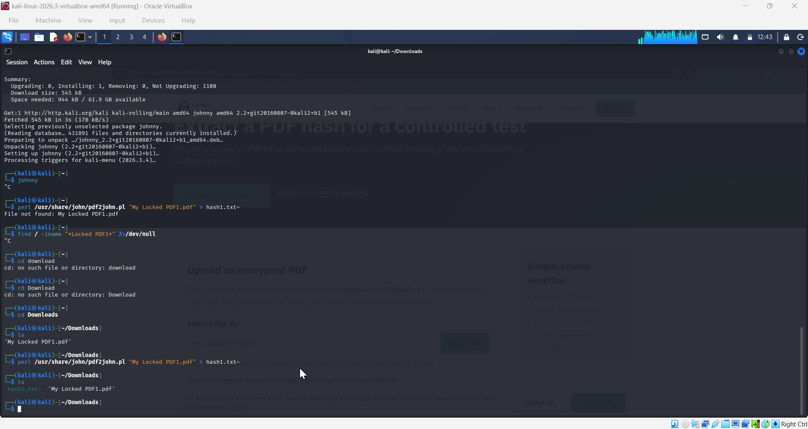
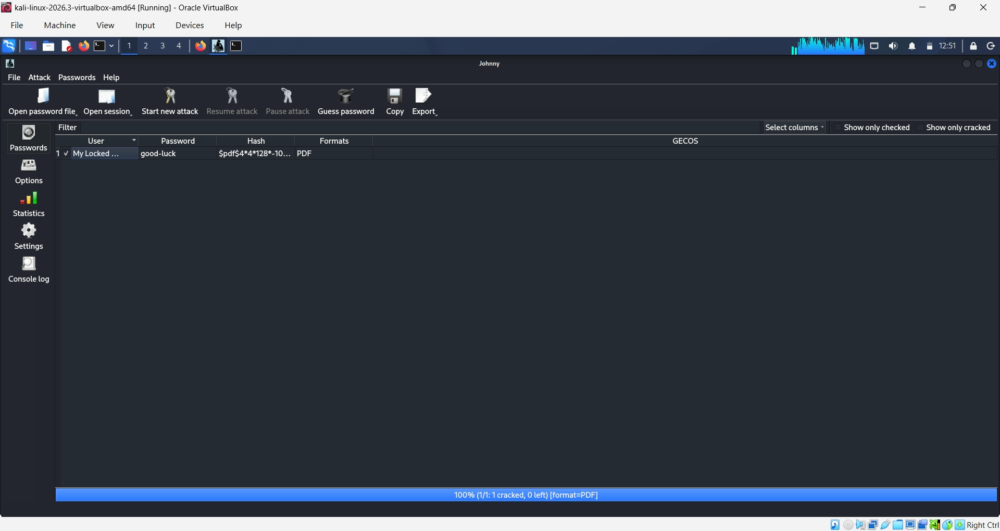
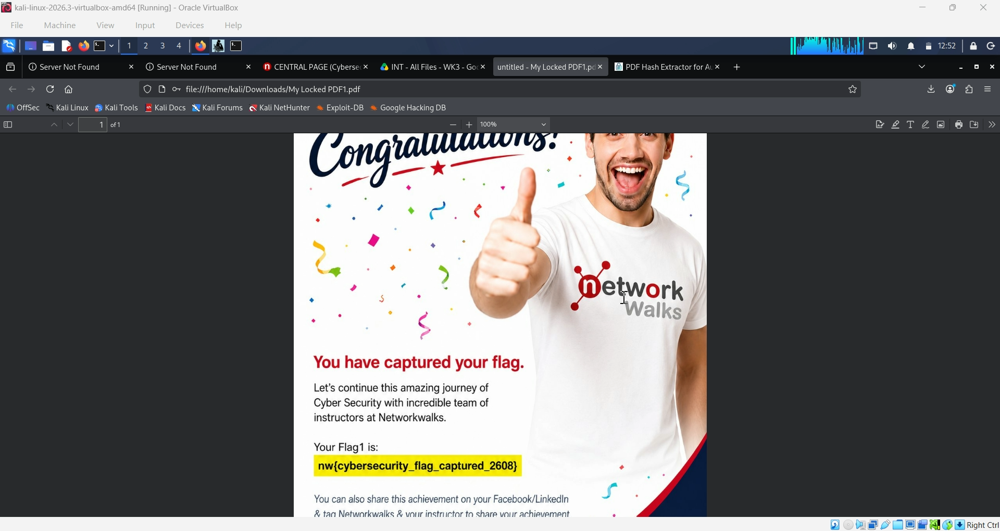
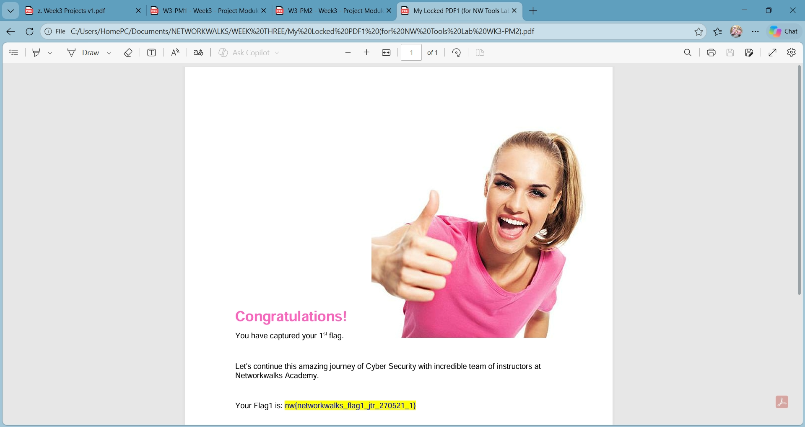

# Week 3 — Password Cracking Labs

Part of my Cybersecurity & Ethical Hacking training journey. This week covered password recovery techniques against a locked PDF file using two different approaches.

## Module 1: Password Cracking with JTR

Tools: John the Ripper (CLI) + Johnny (GUI) on Kali Linux

**Steps:**
1. Extracted the PDF's crackable hash using `pdf2john.pl`
2. Installed Johnny GUI (`sudo apt install johnny`) since it isn't bundled with Kali by default
3. Loaded the hash into Johnny and ran the attack
4. Password recovered: `good-luck`

*Extracting the crackable hash from the locked PDF using pdf2john.pl*

*Johnny completes the attack and recovers the password*

*Flag confirmed after unlocking the PDF with the cracked password*

## Module 2: Password Cracking with NetworkWalks Tools

Tools: NetworkWalks Hash Calculator + Password Cracker (browser-based)

**Steps:**
1. Uploaded the locked PDF to the Hash Calculator to extract the `$pdf$` hash
2. Ran the hash through the Password Cracker's dictionary attack
3. Password recovered: `password1`

*Flag confirmed after unlocking the PDF via the NetworkWalks browser tools*

## Key Takeaways

- Hashing is one-way, encryption is two-way and reversible with the right key
- Weak/common passwords fall quickly even with basic wordlists
- GUI tools aren't always preinstalled, worth knowing the CLI equivalent as backup

## Tools Used
- John the Ripper
- Johnny (JtR GUI)
- NetworkWalks Hash Calculator & Password Cracker

---
*Training provided by Networkwalks Academy*

